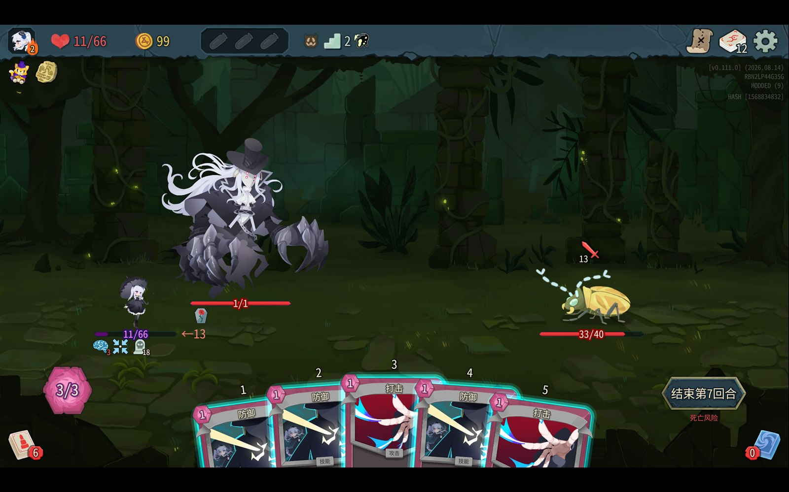

# Death Risk Hint（死亡风险提示）

《杀戮尖塔 2》(Slay the Spire 2) v0.111.0 战斗界面辅助模组 · 作者 **Grisxxx**



## 它做什么

在战斗中的「结束回合」按钮下方加一行红色小字 **死亡风险**：
当你现在按下结束回合、接下来的一整套结算会把你打死时出现。

- 纯客户端 UI 提示，**不影响游戏平衡**（`affects_gameplay: false`）。
- 只在轮到你自己行动、且尚未按下结束回合时计算。
- 敌人攻击伤害直接取自游戏自身的意图计算（`AttackIntent.GetSingleDamage` × `Repeats`），因此力量、虚弱、易伤、钉刺等修正都已包含，与敌人头顶显示的意图数字一致。
- 敌人意图、你的格挡/生命、手牌变化时会实时刷新，刷新间隔 0.1 秒。

## 结算顺序（与游戏一致）

1. **手牌里的「回合结束效果」卡**：燃烧（2）、腐朽（2）、感染（3）、剧毒（5）、凋零（3）等造成伤害，可以被格挡；霉运（13）、召唤（6）直接失去生命，不可格挡；悔恨按手牌数造成不可格挡伤害。
2. **玩家身上的束缚**：回合结束时扣血，可以被格挡。
3. **灾厄**：若剩余生命 ≤ 灾厄层数，直接死亡（无视格挡）。
4. **敌人攻击意图**：逐段结算 —— 先由玩家格挡吸收，未格挡部分**优先由召唤物奥提斯代挡**，奥提斯倒下后才落到玩家身上。
5. **玩家身上的中毒**：下回合开始时结算，不可格挡。

### 奥提斯的代挡规则

奥提斯只代挡「攻击」类伤害（游戏内 `DieForYouPower` 仅对 `ValueProp.Move` 且不带 `Unpowered` 的伤害生效）。
中毒、束缚、状态卡这类 `Unpowered` 伤害会**绕过奥提斯**直接打在玩家身上，本模组在模拟时也是这样处理的。
奥提斯生命不足以吃满伤害时，超出部分不会转移给玩家（游戏内溢出伤害直接丢弃），而是由后续段数继续打。

## 安装

把下面两个文件放进游戏的 `mods` 目录：

```
D:\Slay the Spire 2\mods\DeathRiskHint.dll
D:\Slay the Spire 2\mods\DeathRiskHint.json
```

重启游戏即可，不需要 pck 文件，不依赖 BaseLib 等其它模组。

## 卸载

删除上面两个文件后重启游戏。

## 已知限制

- 敌人在敌人回合内**动态获得**的伤害加成（例如先给你上易伤再攻击）按当前状态估算，可能与最终结果有几点的出入。
- 只处理玩家侧的固定几种持续伤害（中毒 / 束缚 / 灾厄）与手牌回合结束效果卡；其它模组新增的自定义 buff 不参与计算。
- 不模拟「敌人会打断你的格挡」「格挡被消耗」之类的分支，只按意图顺序线性结算。

## 构建

```powershell
$env:PATH="$env:LOCALAPPDATA\Microsoft\dotnet;$env:PATH"
cd sts2_deathrisk
dotnet build -c Release
```

产物在 `bin\Release\net9.0\DeathRiskHint.dll`。工程直接引用游戏目录下的 `sts2.dll` / `GodotSharp.dll` / `0Harmony.dll`（`Private=false`，不复制进输出）。

## 调试

游戏日志里搜索 `[DeathRiskHint]`：

- `[DeathRiskHint] 已加载：...` —— 补丁安装成功。
- `[DeathRiskHint] 提示已挂载。buttonSize=..., visualsSize=..., labelPos=..., resolved=True` —— 小字节点创建成功及定位参数。
- `[DeathRiskHint] risky=True => lethal=True hp=3(+0block)->0 attack=16(blocked 0) other=0(...) osty=... doom=none` —— 计算结果变化记录，含各分项明细。

日志路径：`%APPDATA%\SlayTheSpire2\logs\godot.log`。
